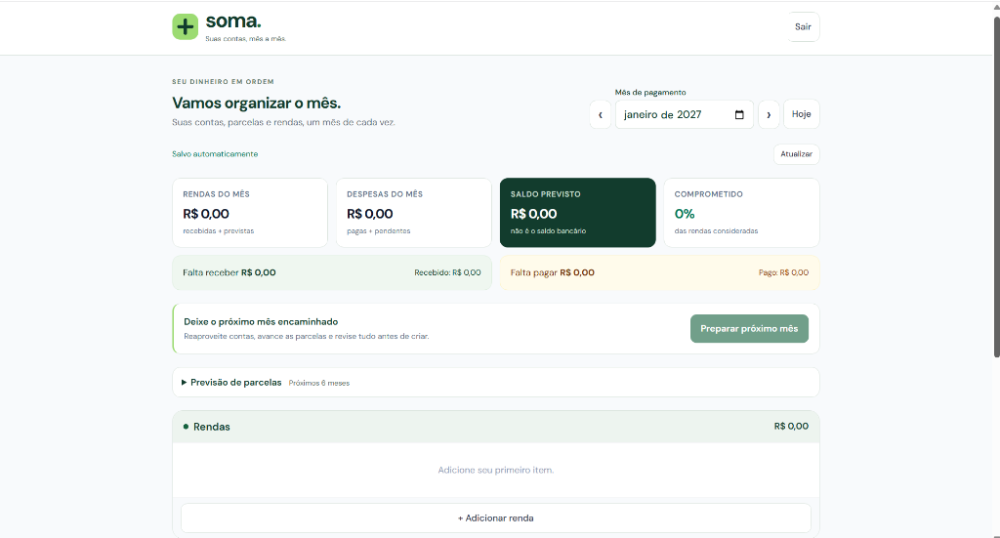
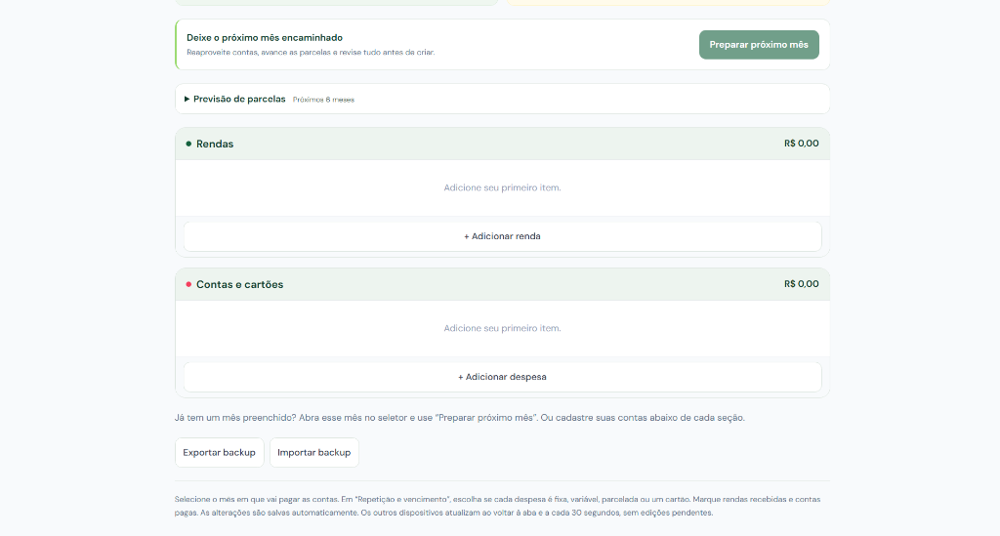

# Soma

**Suas contas, mês a mês.** Planejamento financeiro pessoal com login, parcelas, cartões e sincronização entre dispositivos.

[Acessar o app](https://joaoaquino-dev.github.io/financas-app/) · [Guia de uso](docs/GUIA-DE-USO.md)



> **English:** Soma is a personal finance planner built with React, Tailwind CSS and Supabase. It has email login, monthly planning, card installments and cross-device sync with conflict protection. The detailed documentation below is in Portuguese.

## Sobre o projeto

Comecei o Soma como um controle financeiro simples, que guardava os dados no `localStorage`. Uso o app no dia a dia há meses e, com o tempo, ele passou a ter login e banco de dados, para que o mesmo planejamento fique disponível no celular e no computador.

O foco é responder, mês a mês: quanto entra, quanto sai, o que já foi pago e o que ainda vem em parcelas.

## Funcionalidades

- Planejamento por mês, com rendas e contas fixas, variáveis, parceladas, de cartão ou pontuais.
- Resumo com rendas, despesas, saldo previsto e percentual comprometido.
- Renda recorrente com valor previsto e valor recebido de verdade.
- Cartões com fatura total e detalhamento das parcelas.
- Previsão das parcelas dos próximos 6 meses.
- "Preparar próximo mês": repassa contas e avança parcelas, com revisão antes de salvar. Um mês já existente nunca é sobrescrito.
- Salvamento automático, com aviso antes de fechar a página se houver edições pendentes.
- Exportação e importação de backup em JSON, aceitando também arquivos de versões antigas.
- Login por e-mail e sincronização entre dispositivos.



## Tecnologias

React 18 · Vite 5 · Tailwind CSS 3 · Supabase (Auth e PostgreSQL) · Node test runner · GitHub Actions e GitHub Pages

## Como executar localmente

Pré-requisitos: Node.js 20 ou superior.

```sh
npm ci
npm run dev      # servidor de desenvolvimento
npm test         # testes das regras financeiras e do autosave
npm run build    # build de produção
```

A configuração pública do Supabase fica em `src/lib/supabase.js`. Para usar outro projeto, crie um `.env.local` com `VITE_SUPABASE_URL` e `VITE_SUPABASE_PUBLISHABLE_KEY` e aplique o schema de [`database/schema.sql`](database/schema.sql). Nunca coloque uma chave `service_role` no frontend.

## Estrutura

```
src/
  components/   Telas e componentes (resumo, tabela de lançamentos, previsão)
  hooks/        useFinanceData: carregamento, autosave e conflitos
  lib/          Cliente do Supabase
  utils/        Regras financeiras (finance.js) e moeda (currency.js)
database/       Schema SQL aplicado no Supabase
tests/          Testes das regras de negócio e do autosave
docs/           Guia de uso e capturas de tela
```

## Decisões técnicas e aprendizados

- **Segurança por linha (RLS):** cada linha da tabela `finance_months` pertence a um usuário e as políticas usam `auth.uid()`. A chave *publishable* do Supabase pode ficar no frontend porque só acessa dados do usuário autenticado.
- **Controle de versão no salvamento:** a função `save_finance_month` só grava se a revisão enviada for a atual. Quem editar em um dispositivo desatualizado recebe um conflito em vez de sobrescrever os dados de outro.
- **Um documento por usuário e mês:** o mês é salvo como um JSON versionado (`jsonb`). Isso simplificou o autosave e o "preparar próximo mês", mas limita consultas entre meses. Uma evolução natural seria normalizar rendas e despesas em tabelas próprias.
- **Dados financeiros fora do `localStorage`:** só a sessão de login fica no navegador. O `localStorage` antigo é lido apenas na migração manual.
- **Regras puras e testáveis:** a lógica de virada de mês, parcelas e vencimentos está em `utils/finance.js`, separada da interface, e é coberta por testes.

## Limitações e próximos passos

- Não há edição offline persistente nem pagamentos parciais.
- O "saldo previsto" é um planejamento, não o saldo de uma conta bancária.
- O e-mail padrão do Supabase limita o envio a poucos destinatários. Para abrir cadastros a outras pessoas, seria preciso configurar um SMTP próprio.
- Executar os testes no workflow de CI antes do deploy.
- Normalizar o modelo de dados em tabelas relacionais.

## Como o projeto foi feito

Desenvolvo o Soma com apoio de IA. Eu defino as regras (como as contas passam de um mês para o outro, por exemplo), uso o app no celular, testo o comportamento e reviso as mudanças.

## Autor

João Aquino · [LinkedIn](https://www.linkedin.com/in/jo%C3%A3o-aquino-dev) · [GitHub](https://github.com/joaoaquino-dev)
